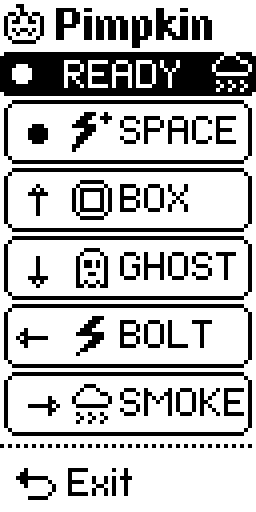

# Pimpkin Remote

A Flipper Zero remote for live shows, in the Flipper's own monochrome style. It
combines a Bluetooth LE HID keyboard with a 315 MHz Sub-GHz smoke machine
start/stop toggle. The arrow keys and OK send ordinary key presses, so it works
with anything that listens to a keyboard: a presentation, a media player, or the
Key blocks of [Scareflow](https://github.com/JorenSix/scareflow), a node-based
show controller for sound, lights and smart plugs.

The app uses a vertical layout: hold the Flipper upright and read the rows top
to bottom. Each row shows the physical control, the cue icon, and the action.



To refresh the screenshot, open the app on a Flipper connected over USB and run:

```sh
uvx --with pyserial --with pillow python scripts/screenshot.py /dev/cu.usbmodemflip_* docs/screenshot.png
```

| Control | Icon | Action |
| --- | --- | --- |
| Dot (OK) | bolt with plus | Send keyboard **Space** |
| Up arrow | box | Send keyboard **Up arrow** |
| Down arrow | ghost | Send keyboard **Down arrow** |
| Left arrow | bolt | Send keyboard **Left arrow** |
| Right arrow | cloud (filled while smoking) | Toggle smoke: first press sends start, next press sends stop (3 times) |
| Back (curling arrow) | back arrow | Exit the app (shown apart, without a frame) |

Under the title sits a black **status pill**:

- **BT dot:** filled when a host is connected, hollow when it isn't.
- **Status text:** `READY`, `PAIR BT`, `SENDING`, `SMOKING`, or a short error.
- **Cloud:** an outline when stopped. It puffs (filled/outline) while smoking. The cloud on the SMOKE row mirrors it.

Exit sits below a dotted rule with no frame, so it doesn't read as a show cue.

The screen is animated:

- The title pumpkin flickers like a candle, and glows brighter while smoking.
- Every few seconds the SPACE and BOLT bolts strike: each blinks off twice, out of sync with the other. A bolt flashes next to the title at the same time.

The RGB LED follows the device conventions: **blue** while a Bluetooth HID key
is held, **magenta/purple** while smoking, and off otherwise.

## Pairing

1. On the Flipper: **Settings → Bluetooth > ON**.
2. Open **Apps → Sub-GHz → Pimpkin Remote**.
3. On the computer/phone, pair with **Pimpkin [your Flipper name]**.
4. Press the Flipper's **OK** button if the host asks to confirm.
5. The header dot fills in when the BLE HID connection is up.

The app advertises as a BLE HID keyboard. It needs a firmware that exposes the
`ble_profile` FAP library; this was tested on **Unleashed 094**. Stock firmware
does not expose BLE HID to external apps.

## Smoke data

The verified 315 MHz Princeton start and stop captures are built into the app:

```text
Start: Key 00 00 00 00 00 45 55 0C, TE 326
Stop:  Key 00 00 00 00 00 45 55 30, TE 321
```

The app writes those captures to disposable temp files in its app-data folder
when it transmits. It never reads or modifies the SD-card recordings.

Before each send the app clears Unleashed's global Sub-GHz button/counter
overrides. The stock Sub-GHz app leaves them set, and the Princeton encoder
would otherwise transmit (and save) a different key than the built-in one.

The smoke action is a toggle with no timer. The first press sends the start
capture once; the next press sends the stop capture **three times**, 200 ms
apart. Sending happens in a worker thread so the UI stays responsive. The state
only flips after a successful send; on an error it stays as it was. Leaving the
app while smoking sends stop first.

The same verified files are kept in `sub/` for reference and for testing with
the stock Sub-GHz app:

```sh
cp sub/smoke_start_315.sub /Volumes/FLIPPER/subghz/smoke_start.sub
cp sub/smoke_stop_315.sub  /Volumes/FLIPPER/subghz/smoke_stop.sub
```

To use different recordings, replace `SMOKE_START_SUB` and `SMOKE_STOP_SUB` near
the top of `pimpkin_remote.c`. The stop capture must contain the real **off**
code; the built-in stop key is `00 00 00 00 00 45 55 30`.

The stop repeats are controlled by constants near the top of `pimpkin_remote.c`:

```c
#define SMOKE_STOP_SENDS   3
#define SMOKE_STOP_GAP_MS  200
```

## Build and install

[ufbt](https://github.com/flipperdevices/flipperzero-ufbt) is the Flipper build
tool. `uv` installs it without touching the system Python:

```sh
uv tool install ufbt
ufbt
ufbt launch          # install to /ext/apps/Sub-GHz and start it
```

The built FAP is `dist/pimpkin_remote.fap`. The helper scripts in `scripts/`
generate the 1-bit PNG icons from ASCII art:

```sh
python3 scripts/make_icons.py
```

## Changing the keyboard cues

The four key mappings are macros at the top of `pimpkin_remote.c`:

```c
#define REMOTE_KEY_UP     HID_KEYBOARD_UP_ARROW
#define REMOTE_KEY_DOWN   HID_KEYBOARD_DOWN_ARROW
#define REMOTE_KEY_LEFT   HID_KEYBOARD_LEFT_ARROW
#define REMOTE_KEY_CENTER HID_KEYBOARD_SPACEBAR
```

Set them to any `HID_KEYBOARD_*` code if your show software expects different
keys. The smoke toggle is always the right-arrow action.

## Notes

- Keys are sent on press and released on release, like the stock Keynote
  remote, so a held arrow repeats on the host.
- Right toggles: start once, then stop **three times** with
  `SMOKE_STOP_GAP_MS` between sends. The cloud shows which command was sent
  last; it is not feedback from the smoke machine itself.
- The RGB LED is blue while a BLE HID key is held and magenta/purple while
  smoking.
- The right action is ignored while a start/stop transmission is in progress.
- Only operate smoke equipment you are authorized to control, and check the
  radio rules for your region.

## Licence

MIT; see [LICENSE](LICENSE).
